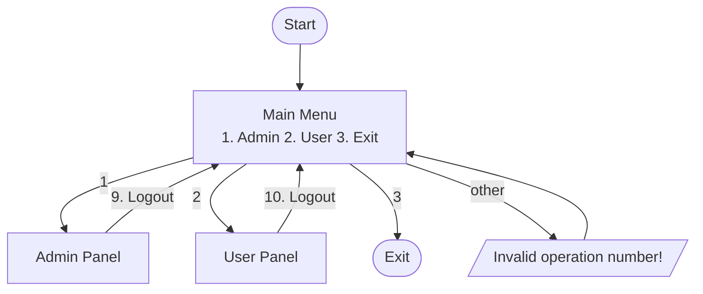
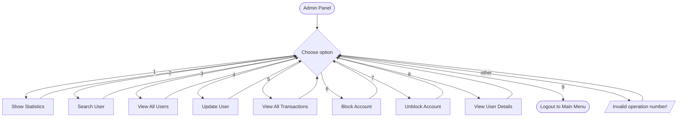
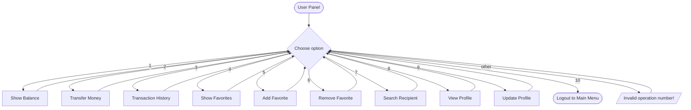
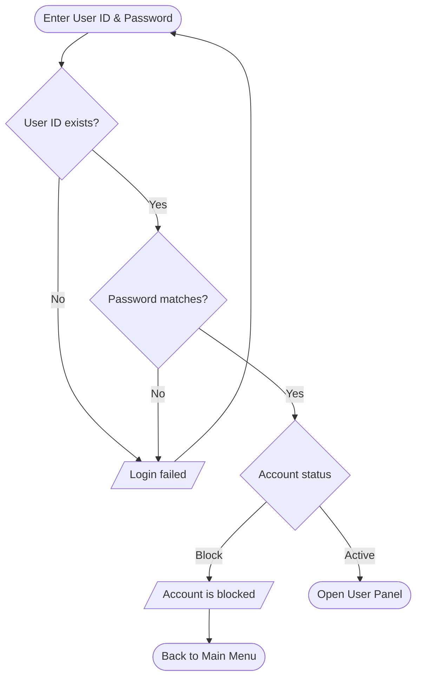
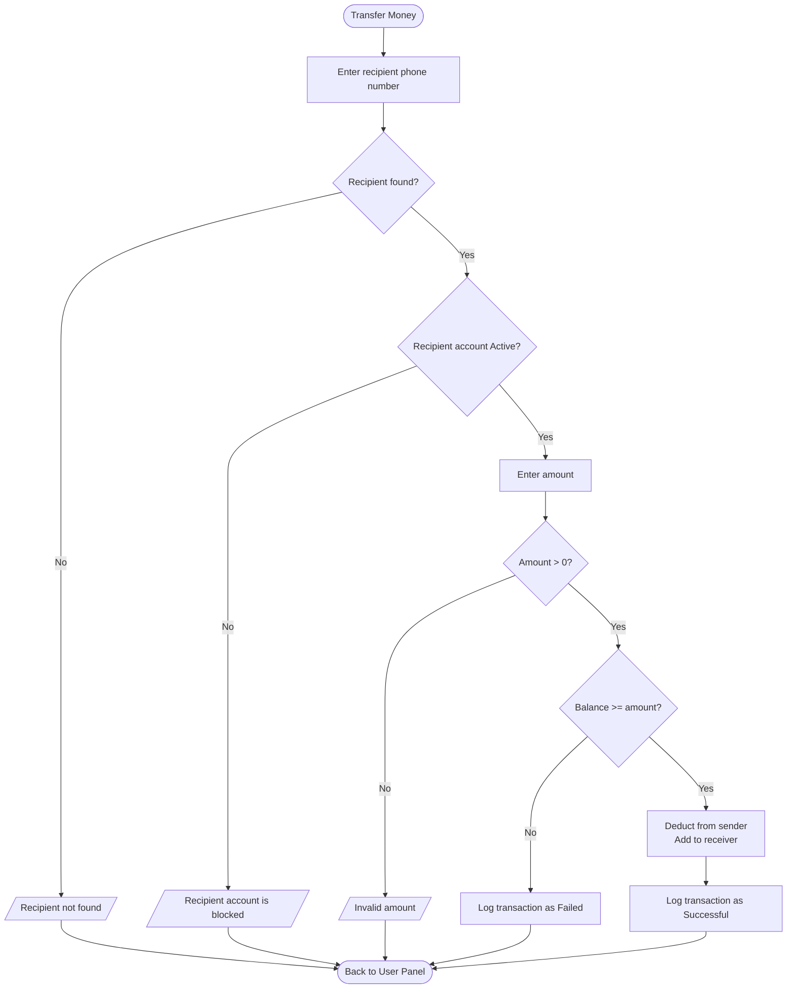
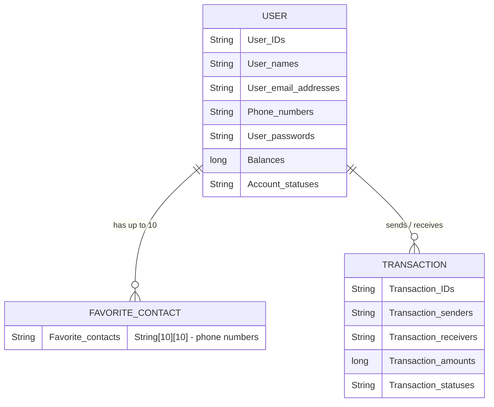

# 💸 Quick Pay

A console-based **digital wallet simulation** written in Java. Quick Pay lets an **Admin** manage accounts and monitor transactions, and lets a **User** check their balance, send money, and manage favorite contacts, all from the terminal.

> Java final project, built by a team of four students using **arrays and `ArrayList`s only** (no database, no external libraries).

---

## 📑 Table of Contents

1. [Features](#-features)
2. [Project Status](#-project-status)
3. [Tech Stack](#-tech-stack)
4. [Getting Started](#-getting-started)
5. [Usage Walkthrough](#-usage-walkthrough)
6. [System Flowcharts](#-system-flowcharts)
7. [Data Model](#-data-model)
8. [Sample Data](#-sample-data)
9. [Project Structure](#-project-structure)
10. [Business Rules](#-business-rules)
11. [Team](#-team)
12. [Future Improvements](#-future-improvements)

---

## ✨ Features

### 👤 User Panel
| # | Option | Description |
|---|--------|-------------|
| 1 | Show Balance | Display the current wallet balance |
| 2 | Transfer Money | Send money to another user |
| 3 | Transaction History | List all transactions the user took part in |
| 4 | Show Favorites | View saved favorite contacts |
| 5 | Add Favorite | Save a contact (by phone number) for quick access |
| 6 | Remove Favorite | Delete a saved contact |
| 7 | Search Recipient | Find a user before sending money |
| 8 | View Profile | See own name, email, phone, status |
| 9 | Update Profile | Edit personal details |
| 10 | Logout | Return to the main menu |

### 🛡️ Admin Panel
| # | Option | Description |
|---|--------|-------------|
| 1 | Show Statistics | Totals for users, balances, and transactions |
| 2 | Search User | Look up a user by ID / name / phone |
| 3 | View All Users | List every registered account |
| 4 | Update User | Edit a user's information |
| 5 | View All Transactions | Full system-wide transaction log |
| 6 | Block Account | Set an account's status to `Block` |
| 7 | Unblock Account | Set an account's status back to `Active` |
| 8 | View User Details | Show everything about one user |
| 9 | Logout | Return to the main menu |

---

## 🚧 Project Status

| Module | Status |
|--------|--------|
| Main menu (Admin / User / Exit) | ✅ Done |
| Admin & User menu navigation (`switch` skeleton) | ✅ Done |
| Data storage (parallel arrays + `2D-Arrays`s) | ✅ Done |
| Login / authentication | Done |
| Admin operations (1–9) | Done |
| User operations (1–10) | Done |
| Menu loops / input validation | Done |

---

## 🧰 Tech Stack

- **Language:** Java (JDK 8 or newer)
- **Input:** `java.util.Scanner` (console)
- **Storage:** In-memory arrays and `2D-Arrays` (data resets when the program exits)
- **IDE:** IntelliJ IDE (the package name `com.mycompany.main` )

---

## 🚀 Getting Started

### Prerequisites
- JDK 8+ installed (`java -version` to check)

### Run from an IDE
1. Clone or download the project.
2. Open it in NetBeans / IntelliJ / VS Code.
3. Run `Main.java`.

### Run from the terminal
```bash
# From the project root (the folder containing "com")
javac com/mycompany/main/Main.java
java com.mycompany.main.Main
```

---

## 🖥️ Usage Walkthrough

```text
========== QUICK PAY ==========
1. Login as Admin
2. Login as User
3. Exit
Choose an option:
```

Choosing **1** opens the Admin Panel, **2** opens the User Panel, and **3** exits. Any other number prints `invalid operation number !`.

```text
========== USER PANEL ==========
1. Show Balance
2. Transfer Money
3. Transaction History
4. Show Favorites
5. Add Favorite
6. Remove Favorite
7. Search Recipient
8. View Profile
9. Update Profile
10. Logout
Choose an option:
```

---

## 🗺️ System Flowcharts

> These diagrams use [Mermaid](https://mermaid.js.org/) and render automatically on GitHub, GitLab, and most Markdown viewers.

### 1. Overall Program Flow



### 2. Admin Panel Flow



### 3. User Panel Flow



### 4. Login Flow



### 5. Transfer Money Flow



---

## 🗃️ Data Model

Quick Pay stores data in **parallel arrays**: the same index across every array refers to the same user. For example, index `6` is Eyad's ID, name, email, phone, password, balance, status, and favorites row.


---

## 📁 Project Structure

```text
QuickPay/
├── README.md
└── src/
    └── com/
        └── mycompany/
            └── main/
                └── Main.java      # Entry point: menus, data arrays, program logic
```

---

## 📜 Business Rules

- A user can only log in if their account status is **Active**.
- A **blocked** account cannot send or receive money.
- A transfer amount must be **greater than zero**.
- A sender cannot transfer **more than their balance**.
- A user cannot transfer money to **themselves**.
- Every transfer attempt is recorded with a **unique transaction ID** and a **status**.
- Only an **Admin** can block, unblock, or update other users' accounts.
- Each user can store up to **10 favorite contacts**, with no duplicates.

---

<p align="center">Made with ☕ and Java</p>
